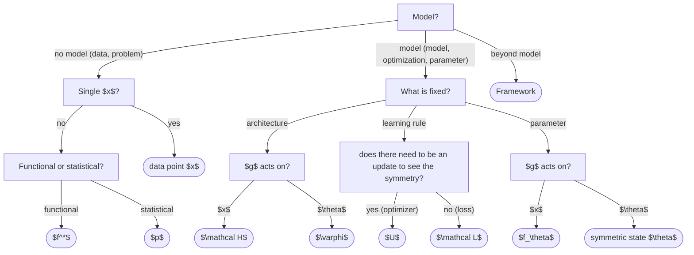
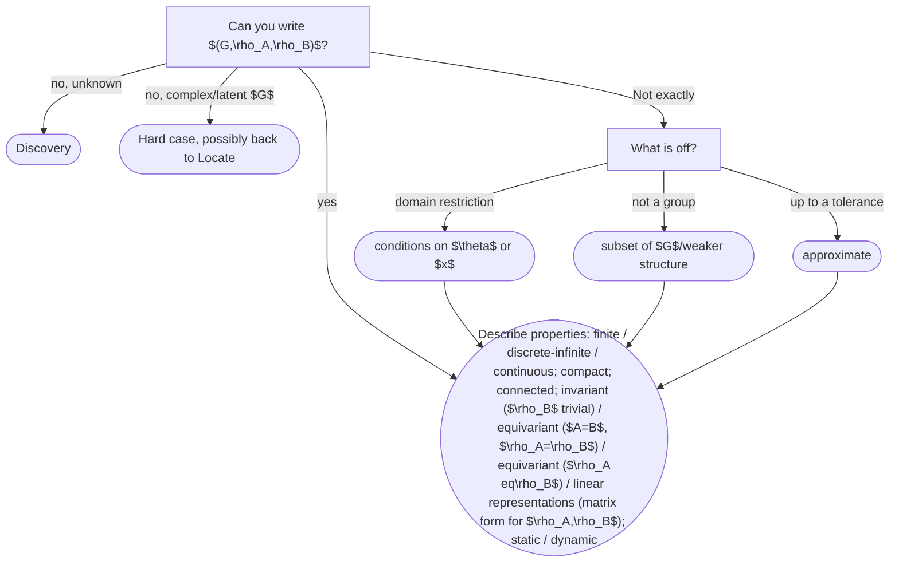

# Decision tree / pipeline for when and how to reason with a symmetry
A guide breaking down the appropriate behavior when encountering a symmetry.

Steps:
1. Entry point: what triggers a symmetry-encounter?
2. Locate: find the symmetry locus as a first reflex
3. Characterize: describe the symmetry and its properties
4. Act: what do we want and what can we do; Locate and Characterize steps should orient us
5. Diagnose: not a step but if something goes wrong, how do we catch it?

The figure reads as the taxonomy turned into a procedure, with some extras.
Taxonomy axes (\Cref{tab:taxonomy}) per step: Entry point = A priori knowledge; Locate = Object; Characterize = Exactness, State; Act = Purpose.
Explicitness is discarded.
Other questions (group properties, form of the action...) go beyond the taxonomy in Characterize and Act.
As a practical guide, the audience is practitioners.

**Figure guidelines**
The figure is a progression for steps 1 to 4, step 5 is a feedback/warning so it is not really inside the progression.
Loci of \Cref{fig:sym-loci} are leaves of a decision tree in step 2, these leaves should be colored in accordance with \Cref{fig:sym-loci}.
Colors of \Cref{fig:sym-loci} (Okabe–Ito): Problem `#0072b2`, Model `#009e73`, Optimization `#e69f00`, Parameter `#d55e00`, Data `#cc79a7`, Framework `#777777`.
It would be nice to add segments (sections, subsections, subsubsections, paragraphs) as tags (post-its way) freely where they apply.
There will be some text in the figure, but it should be as simple as possible, do not overload the figure with text.
Match the style of other figures.

## 1. Entry points

Initially, one might have more or less a priori knowledge on the symmetry.
The symmetry might be:
- *Given* by the problem or an article (known)
- *Assumed* if it is a candidate whose validity is unchecked (unknown validity)
- *Suspected* (unknown, at least partially)

## 2. Locate
**Goal** identify the spaces and the locus (box in \Cref{fig:sym-loci}), i.e. the Object axis.
It answers the question: "of which object is the symmetry a property?" with a compact decision tree.

**Output** the map $f:A \to B$ along with domain $A$ and codomain $B$ (for the data and symmetric-state loci, a point $a\in A$ with $g\cdot a=a$).

Decision tree, whose leaves are boxes of \Cref{fig:sym-loci}:

Comments:
- The first step asks if the symmetry needs to be conceived relative to a model because it is a natural framing for a deep learning practitioner.
- To separate (problem, data): data is about symmetry of $x$ as an object (in the strong sense of \Cref{sec:what-is-sym}).
Problem involves either a task relating two spaces through the ground truth $f^*:\mathcal{X}\to \mathcal{Y}$ or multiple points through the data distribution $p$.
- The framework locus is diverse (it is characterized by being not a symmetry of $x$ nor $\theta$), hence we do not split it further.
- instance-level and data row $\varphi$ are left out on purpose as subcase of $\varphi$

There might be multiple symmetries and loci (following arrows of \Cref{fig:sym-loci} can suggest related ones).
If this is the case, repeat (↻) these steps.

## 3. Characterize
**Goal** gather information about the symmetry

**Output** if possible, $(G,\rho_A,\rho_B)$ plus Exactness/Known/State tags and properties.

Comments:
- In case of a complex/latent $G$, there is no straightforward algebraic form for the action of $g$. Latent means some $G$ is acting in a space but the change is visualized in another e.g. 3D rotation in 2D with occlusions. An example of complex invariance is identity under aging (might also be latent).
- The characterization determines the tools available (\Cref{sec:edl-achieving-equiv,sec:lie-algebra}).

## 4. Act
This is the purpose axis extended beyond the binary "prescriptive" or "descriptive".
This could simply be a list with a sideways band or separation of "prescriptive" for neutralize and exploit and "descriptive" for discover/describe and explain/understand.
It is not necessary to write everything, the top level can be enough.

Possible interactions:
- Discover/describe the symmetry itself
    - Find the symmetry group (discovery)
    - Formalize an intuitive/empirical observation
    - Give a new perspective on a subfield (framework symmetries)
    - Unify previous works by generalizing symmetry treatment
- Explain/understand its consequences
    - List conservation laws
    - Analyze the effect of a symmetry on training dynamics
    - Characterize a fiber of the implementation map
- Neutralize
    - Remove
    - Quotient
    - Align, canonicalize
- Exploit
    - Design an equivariant layer/network
    - Make a network more equivariant (data augmentation, soft penalty)
    - Find an application (e.g. teleportation, pruning)

## 5. Diagnose/warnings/feedback
**Goal** list some ways to diagnose whether something is wrong
This could be represented as a backward arrow at the top.

Cues that something is wrong, mechanisms to find that something is not right, guardrails:
- Functional SB (\Cref{sec:functional-sb}): an equivariant model cannot fit the train set; ill-posed task due to Curie obstruction (\Cref{par:curie-principle}) e.g. a task asking $\operatorname{Stab}(f^*(x))\subsetneq\operatorname{Stab}(x)$.
- Distributional SB (\Cref{sec:distributional-sb}): a two-sample classifier can tell $p$ from its symmetrized version; possible symmetry-biased dataset
- Dynamical SB (\Cref{sec:dynamical-sb}): there is a temporal aspect to consider (a conserved quantity drifts in practice)
- An equivariance error is large (\Cref{sec:sym-quantification}), discovery/quantification disagrees with the assumed group
- Weak signal: an equivariant model loses against an unconstrained one (or augmented one). Not necessarily conclusive, since this also happens with a correct symmetry under distributional SB or optimization difficulties (\Cref{sec:distributional-sb,sec:edl-tradeoffs}).

# Unused

Use the symmetry as a prior (\Cref{fig:five-routes}):
- Should I hard-code it / Do I have competencies and time to develop an equivariant model (symmetry bottleneck, \Cref{par:sym-bottleneck})? Is it worth it (\Cref{sec:edl-tradeoffs}: how well the data satisfy it, its learnability, compute)? If yes, should I try something in-between to still allow it to break (\Cref{sec:approx-relaxed,sec:subgroups})?
- If not, augment for it (\Cref{sec:data-augmentation}), regularize toward it with an unconstrained model (\Cref{sec:approx-soft}), or let it be learned (then check, \Cref{sec:sym-quantification})

Validity of $G$ can be measured (\Cref{sec:sym-quantification}).

weaker structure (\Cref{tab:extent-restriction})
