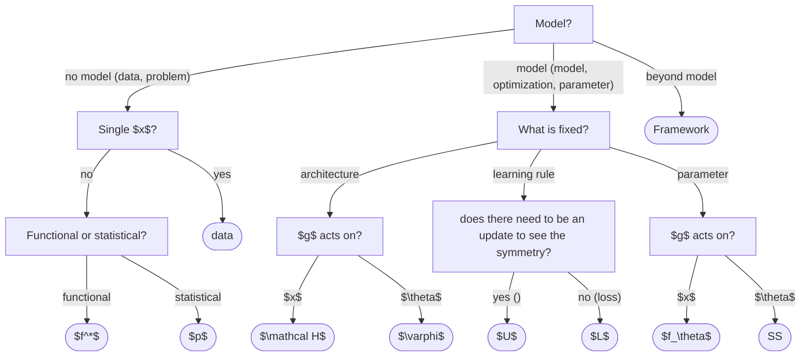

# Decision tree / pipeline for when and how to reason with a symmetry
A decision tree/sequence of steps to guide the exploration phase when encountering a symmetry.

A progression in steps:
1. Entry point: what triggers the fact of reasoning about symmetry?
2. Locate: find the symmetry locus
3. Characterize: describe the symmetry and its properties
4. Act: what do we want to do; Locate and Characterize steps should orient us
5. Diagnose: if something goes wrong, how do we catch it?

Taxonomy axes (\Cref{tab:taxonomy}) per step: Locate = Object; Characterize = Exactness, A priori knowledge, State; Act = Purpose.
Explicitness is discarded.
Other questions (group properties, form of the action, cost of equivariance) go beyond the taxonomy.
The figure reads as the taxonomy turned into a procedure, with some extra.

**Figure**
The figure progresses from left to right.
Step 1 is the entry, it could be three icons and should not take much space. 
Steps 2-4 are the three main phases, organized as sequential panels.
Step 5 is a feedback/warning, it could be an arrow pointing backward.
Loci should be indicated as leaves in 2., and segments (sections, subsections, subsubsections, paragraphs) as clickable tags where they apply.
Reuse the row colors from the loci figure (blue, green, yellow, orange, pink, grey) for the Locate leaves, and again on the Act leaves.

## 1. Entry points

Initially, one might have more or less information on the symmetry.
A symmetry can be:
- *Given* by the problem or an article (known)
- *Assumed* if it is a candidate whose validity is unchecked
- *Suspected* (unknown, at least partially)

## 2. Locate
**Goal** describe how to pick the box (locus) in \Cref{fig:sym-loci}, i.e. the Object axis.
It should consist of a small decision tree to identify the locus and answer the question: of which object (usually a map $f$) is the symmetry a property?

**Output** The map $f:A \to B$ where there is a symmetry and its domains and codomain.

Comments:
- A natural first step is to ask if the symmetry needs to be conceived relative to a model.
- To separate (problem, data): data is about a single fixed point $x$, $g\cdot x=x$, a symmetry about $x$ as an object (in the strong sense of \Cref{sec:what-is-sym}). Problem involves either a task relating two spaces through the ground truth $f^*:\mathcal{X}\to \mathcal{Y}$ or multiple points through the data distribution $p$.
- To separate (model, optimization, parameter), parameter involves a fixed parameter $\theta$, then the symmetric state $g\cdot\theta=\theta$ is a symmetry of the parameter vector while the implementated function relate input and output spaces. Model is about the architecture, valid for every $\theta$, and its two loci are distinguished by whether $G$ acts on the task (hypothesis class $\mathcal{H}$, $G$ on $\mathcal{X},\mathcal{Y}$) or on the representation of the model (implementation map $\varphi$, $G$ on $\Theta$). Optimization involves the learning rule: the objective (loss $\mathcal{L}$) or the optimizer (update rule $U$, iterated over timesteps).
- The framework locus is diverse; it is characterized by being not a symmetry of $x$ nor $\theta$.
$3$ examples are given in the survey but they are not all.

Now, it should be possible to attempt writing the domain and codomain of $f$.

There might be multiple symmetries and loci. If this is the case, repeat these steps. The arrows of \Cref{fig:sym-loci} can suggest other related loci.

## 3. Characterize
**Goal** list all important information about the symmetry. It could organize the questions in multiple mini decision-trees, in the best logical order.

**Output** $(G,\rho_A,\rho_B)$ plus its Exactness/Known/State tags and properties

Is it possible to write the triplet $(G, \rho_X, \rho_Y)$?
Is there an algebraic form for the action of $g$?
- If not, is it because the symmetry is complex but there is an underlying symmetry (3D rotation seen in 2D), because it is not a true symmetry (incomplete), or because it is unknown?
- If yes, can $\rho_X$ and $\rho_Y$ be written as matrices (linear representations)?

Is $(G, \rho_X, \rho_Y)$ known? If only a candidate is known, its validity can be measured (\Cref{sec:sym-quantification}).

Properties of $G$ as a group (\Cref{sec:groups})
- Continuous or discrete?
    - If discrete, is it finite or infinite?
    - If continuous, is it connected?
- Is it compact?
These determine the available tools (\Cref{sec:edl-achieving-equiv,sec:lie-algebra}).

How does $G$ act:
- Invariantly or equivariantly? If equivariant, is the action the same on input and output space (\Cref{ex:one-rotation-several-forms})?

Does $G$ formally verify the group axioms?
- If not, describe the actual weaker structure (\Cref{tab:extent-restriction}).
- If yes, does the symmetry always hold fully (exact)?
    - If not, does it depend on time (dynamic, State axis), hold only on part of the domain (extent-restricted, domain case), only on a subgroup (extent-restricted, subgroup case), or up to a tolerance (approximate)?

If $G$ is found to not be exact, revisiting "Locate" might be necessary.

## 4. Act
This is the purpose axis extended beyond the binary "prescriptive" or "descriptive".

What do we want to do?
- Discover/describe the symmetry itself
    - Find the symmetry group (discovery)
    - Formalize an intuitive/empirical observation
    - Give a new perspective on a subfield (framework symmetries) or unify previous works
    - Precise the structure if not a group
- Explain/understand its consequences
    - List conservation laws
    - Analyze the effect of a symmetry on training dynamics
    - Characterize a fiber of the implementation map
- Account for
    - Remove it
    - Quotient it
    - Align, canonicalize
- Exploit
    - Design an equivariant layer/network
    - Make a network more equivariant (data augmentation, soft penalty)
    - Find an application (e.g. teleportation, pruning)

## 5. Diagnose/warnings
How do I diagnose whether the assumed symmetry is actually wrong?
Cues that something is wrong, mechanisms to find that something is not right, guardrails.
- An equivariance error is large (\Cref{sec:sym-quantification})
- An ill-posed task Curie obstruction: the task needs $\operatorname{Stab}(f^*(x))\subsetneq\operatorname{Stab}(x)$.
- A two-sample classifier can tell $p_X$ from its symmetrized version leads to questions on an evaluation dataset
- A conserved quantity drifts in practice
- Symmetry breaking (\Cref{table:symmetry-breaking}) is at play
- Discovery/quantification disagree with the assumed group
- An equivariant model loses against an unconstrained one (or augmented one). Caveat: not necessarily conclusive, since this also happens with a correct symmetry under distributional SB or optimization difficulties (\Cref{sec:distributional-sb,sec:edl-tradeoffs})

# Unused

Act: is it a bug, a feature, a prior, an object of study or something to discover?

If it was not possible to write $(G, \rho_X, \rho_Y)$, is it because the symmetry is unknown and discovery is the objective?

Use the symmetry as a prior (\Cref{fig:five-routes}):
- Should I hard-code it / Do I have competencies and time to develop an equivariant model (symmetry bottleneck, \Cref{par:sym-bottleneck})? Is it worth it (\Cref{sec:edl-tradeoffs}: how well the data satisfy it, its learnability, compute)? If yes, should I try something in-between to still allow it to break (\Cref{sec:approx-relaxed,sec:subgroups})?
- If not, augment for it (\Cref{sec:data-augmentation}), regularize toward it with an unconstrained model (\Cref{sec:approx-soft}), or let it be learned (then check, \Cref{sec:sym-quantification})